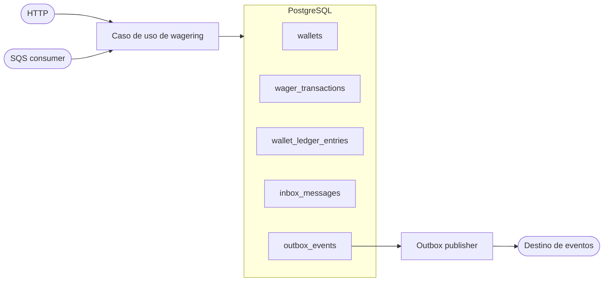

# Arquitetura

Este documento descreve as decisões arquiteturais do BetSystem em relação ao
desafio [backend-challenge-go](https://github.com/junglegaming/backend-challenge-go).
Ele tem dois objetivos: registrar as garantias que a solução deve preservar em
produção e deixar explícito o estado atual do repositório. Uma decisão descrita
como alvo não deve ser interpretada como funcionalidade já entregue.

## Visão geral

O sistema processa operações financeiras de provedores de jogos sobre carteiras
de jogadores. O processamento é orientado a banco de dados: a carteira, a
transação, o ledger, a inbox e os eventos de outbox são persistidos no PostgreSQL
em uma única transação sempre que pertencem ao mesmo comando.



HTTP e SQS são apenas adaptadores de entrada. Ambos devem chamar o mesmo caso
de uso e, portanto, aplicar as mesmas validações, regras de idempotência e
transições de domínio. Nenhum lock em memória é usado como garantia financeira;
várias instâncias podem executar simultaneamente com conexões independentes.

## Estrutura de pacotes

* `internal/domain`: entidades, value objects, regras e erros de negócio. Não
  depende de HTTP, SQS, GORM, Fx ou Keycloak.
* `internal/application`: casos de uso e portas para repositórios,
  transações, autenticação e mensageria.
* `internal/infrastructure/postgres`: conexão, migrations, modelos, mappers,
  repositórios e gerenciamento de transações.
* `internal/infrastructure/keycloak`: validação de tokens OIDC emitidos pelo
  Keycloak.
* `internal/presentation/http`: roteamento, middleware, DTOs e handlers.
* `internal/bootstrap`: composição da aplicação e ciclo de vida com Uber Fx.
* `tests/integration`: testes contra PostgreSQL e dependências reais em
  containers.

Os construtores recebem interfaces nas fronteiras da aplicação. A composição
concreta fica em `bootstrap`, evitando que regras de domínio conheçam detalhes
de infraestrutura.

## Decisões arquiteturais

### Monólito modular

Foi escolhido um monólito modular porque o desafio avalia principalmente
consistência financeira, concorrência e recuperação de falhas. Manter os
casos de uso no mesmo processo reduz a complexidade operacional e permite
compartilhar as mesmas regras entre HTTP e mensageria, sem transformar cada
fronteira em um serviço independente prematuramente.

O monólito não depende de memória local para garantir consistência. O estado
financeiro fica no PostgreSQL e pode ser acessado por várias instâncias da
aplicação. Assim, a solução pode evoluir para múltiplos processos sem alterar
as regras do domínio.

### Separação por camadas

O código segue uma separação inspirada em arquitetura hexagonal: o domínio
define as regras, a aplicação coordena os casos de uso e as portas, e a
infraestrutura implementa persistência, autenticação e mensageria. Essa escolha
evita que uma decisão de framework altere regras como débito, crédito,
idempotência ou transições de estado.

### HTTP com Gin

Gin foi escolhido por oferecer roteamento, grupos de rotas, middleware e
serialização JSON com pouca configuração. Ele fica restrito à camada de
apresentação; handlers convertem HTTP em comandos da aplicação e não executam
regras financeiras diretamente. Isso mantém a mesma lógica disponível para o
consumidor SQS.

### PostgreSQL como autoridade financeira

PostgreSQL foi escolhido porque o desafio exige persistência relacional e
porque transações, constraints, índices únicos e locks por linha são adequados
às invariantes do sistema. A aplicação não considera uma operação confirmada
até o commit do banco.

### GORM pela simplicidade

GORM foi escolhido pela simplicidade de integração com Go e pela redução de
boilerplate na persistência: modelos, conexão, transações e mapeamento ficam
concentrados na infraestrutura. A escolha também acelera a evolução do
projeto sem espalhar SQL de baixo nível por todos os casos de uso.

Essa simplicidade não deve esconder as garantias importantes. Por isso, o
projeto mantém migrations versionadas e usa clauses explícitos para
`FOR UPDATE`, constraints e transações. O domínio não conhece GORM e os
repositórios expõem interfaces para a aplicação. `pgx` com SQL explícito seria
uma alternativa válida e possivelmente mais previsível em consultas complexas,
mas não foi adotada porque o ganho de simplicidade do GORM atende ao escopo
atual.

### Keycloak por exigência do desafio

Keycloak foi escolhido principalmente porque o desafio exige autenticação com
um IdP externo OAuth 2.0/OIDC e recomenda seu uso em Docker Compose. Ele
permite validar tokens sem implementar cadastro de senha ou emissão própria de
credenciais, além de fornecer roles e identidade do provedor para autorização.

O serviço usa discovery OIDC e validação de assinatura, issuer, client e
expiração. A aplicação extrai o `providerId` da identidade autenticada para
impedir que um provedor consulte ou altere dados de outro. A autenticação fica
em `infrastructure/keycloak` e o restante do sistema depende apenas da
interface `auth.Verifier`.

### Uber Fx para composição e ciclo de vida

Uber Fx foi escolhido porque é requisito da stack do desafio e porque organiza
a criação das dependências sem acoplá-las ao domínio. Os módulos registram
conexão, repositórios, casos de uso, servidor e workers; `fx.Lifecycle` reúne
inicialização e encerramento ordenado.

### Dinheiro como centavos inteiros

Valores monetários usam `int64` em unidades mínimas e escala fixa de duas
casas. Essa decisão elimina erros de arredondamento de ponto flutuante e deixa
o valor persistido exatamente igual ao valor processado. O contrato HTTP usa
strings decimais para não perder precisão durante JSON.

### Lock pessimista por carteira

Foi escolhido `SELECT ... FOR UPDATE` por carteira em vez de locks globais ou
locks em memória. O PostgreSQL coordena instâncias independentes, serializa
apenas operações que disputam a mesma carteira e mantém carteiras diferentes
em paralelo. A atualização do saldo e o lançamento correspondente ficam no
mesmo commit.

### Inbox e transactional outbox

Inbox e outbox foram escolhidas para lidar com entrega at-least-once. A inbox
evita o reprocessamento de uma mensagem já confirmada; a outbox evita perder
um evento depois que a transação financeira foi confirmada. A publicação é
separada do caso de uso, permitindo retry, disputa entre publishers e
recuperação após reinício sem manter uma chamada externa dentro da transação
financeira.

### Docker Compose no ambiente local

Docker Compose reúne PostgreSQL, Keycloak, MiniStack e a aplicação com versões
reproduzíveis para desenvolvimento e testes de integração. O MiniStack fornece
o endpoint local compatível com SQS, enquanto o Keycloak importa o realm de
teste automaticamente.

## Composição e ciclo de vida

Uber Fx é o composition root. Os módulos registrados em `bootstrap.Modules`
fornecem configuração, cliente do PostgreSQL, repositórios, verificador OIDC,
servidor HTTP, consumidor SQS e publishers da outbox.

Cada componente de longa duração deve registrar um `fx.Hook`:

1. `OnStart` valida configuração, dependências e conectividade, depois inicia o
   servidor, o consumidor e os publishers.
2. Ao receber `SIGTERM`, o componente para de aceitar novo trabalho e cancela
   os polls. O trabalho já adquirido termina dentro do prazo de shutdown ou é
   liberado para reentrega.
3. `OnStop` aguarda os workers, fecha o cliente SQS e fecha o pool do banco
   depois que nenhum componente ainda o utiliza.

O domínio não importa Fx. O `context.Context` é propagado para todo I/O e os
timeouts são definidos na borda de cada operação.

## Modelo de domínio

### Money

`money.Money` é um value object imutável na prática: suas operações retornam um
novo valor e não alteram o original. O valor é armazenado como `int64` em
centavos (`AmountMinor`) e a moeda como código ISO de três letras normalizado em
maiúsculas. Nenhum caminho financeiro usa `float32` ou `float64`.

Entradas externas usam `{ "amount": "25.00", "currency": "BRL" }`. O parser
rejeita valor vazio, notação científica, `NaN`, infinito, escala maior que duas
casas, moeda inválida, overflow e, nas entradas financeiras externas, valores
negativos. A aritmética verifica moeda compatível e overflow; valores negativos
continuam permitidos em diferenças internas, mas nunca no saldo.

No PostgreSQL, `amount_minor`, saldo e snapshots financeiros são `BIGINT`, com
`currency CHAR(3)`. A serialização volta para decimal com exatamente duas casas.
O limite numérico é o limite do `int64` em centavos, e parsing, soma, subtração
e negação devem rejeitar overflow em vez de arredondar.

### Wallet

Wallet é a raiz do agregado financeiro. `(player_id, currency)` é único. O
agregado controla crédito, débito, moeda e não negatividade do saldo; a versão
só aumenta quando o saldo muda. Toda mudança financeira gera exatamente um
lançamento de ledger no mesmo commit.

### WagerTransaction

Uma transação externa contém provedor, identificador externo, chave de
idempotência, hash do payload, jogador, carteira, rodada, jogo, tipo, valor,
referência, estado, falha e resultado financeiro persistido. `OPENING` é uma
origem interna e não aceita metadados externos.

Estados:

* `PENDING`: recebida, ainda não concluída;
* `PENDING_REFERENCE`: aguardando uma referência persistida;
* `PROCESSED`: concluída com sucesso;
* `REJECTED`: rejeitada por regra de negócio;
* `FAILED`: falha permanente de infraestrutura registrada para auditoria.

Estados terminais não têm novas transições. Replay consulta o registro e o
resultado persistido; nunca reaplica a movimentação.

### Ledger

`wallet_ledger_entries` é append-only. Cada lançamento registra carteira,
transação, direção, valor, saldo anterior, saldo posterior e instante. A
unicidade `(wallet_id, transaction_id)` impede dois lançamentos para a mesma
operação. Constraints verificam a equação do saldo, valor positivo e saldo
posterior não negativo; triggers impedem `UPDATE` e `DELETE`.

`LOSS` pode ser processada com valor zero, mas não cria lançamento nem altera a
versão da carteira. Operações rejeitadas também não criam lançamento.

## Transações e concorrência

O caso de uso abre uma transação SQL e executa, nessa ordem, a deduplicação, a
resolução da referência, o lock da carteira, a transição de domínio, a gravação
da carteira, da transação, do ledger e dos eventos de outbox. Qualquer erro
desfaz o conjunto inteiro.

A estratégia escolhida é lock pessimista por carteira: `SELECT ... FOR UPDATE`
é executado dentro da transação. Assim, duas apostas em carteiras diferentes
continuam em paralelo, enquanto duas operações na mesma carteira são
serializadas pelo PostgreSQL. A verificação do saldo ocorre depois do lock; não
há lost update nem saldo negativo mesmo com várias instâncias.

O lock não deve ser mantido durante chamadas HTTP, SQS ou outros serviços. A
transação contém somente operações de banco e domínio. O banco é a autoridade
final, independentemente de locks locais, ordenação FIFO ou deduplicação do
broker.

## Idempotência

A idempotência é durável e sobrevive ao reinício dos processos.

Para cada operação externa são aplicadas duas unicidades:

* `(provider_id, external_transaction_id)` identifica a operação do provedor;
* `idempotency_key` identifica a tentativa lógica recebida pelo sistema.

O servidor persiste um hash SHA-256 de um JSON canônico dos campos de negócio:
`providerId`, `externalTransactionId`, `playerId`, `walletId`, `roundId`,
`gameId`, `kind`, `money` e `referenceExternalTransactionId`. A chave de
idempotência e metadados de transporte ficam fora do
hash. Strings e moeda são normalizadas antes do hash e a ordenação de chaves é
determinística.

Chave e hash iguais retornam o resultado persistido, incluindo o saldo observado
no processamento original e `idempotentReplay: true`. Chave reutilizada com
payload diferente retorna conflito. O mesmo negócio com outra chave também é
conflito, nunca uma nova movimentação.

No SQS, `messageId` é deduplicado adicionalmente por
`(consumer_name, message_id)` na inbox. Reentrega com hash diferente é erro de
mensagem e não pode alterar o domínio.

## Operações e referências

As regras são:

| Tipo         | Efeito               | Condição principal                                   |
| ------------ | -------------------- | ------------------------------------------------------ |
| `BET`      | débito              | valor positivo e saldo suficiente                      |
| `WIN`      | crédito             | valor positivo                                         |
| `LOSS`     | nenhum               | valor exatamente`0.00`                               |
| `REFUND`   | crédito             | referência a`BET` processada                        |
| `ROLLBACK` | movimento contrário | referência a`BET`, `WIN` ou `REFUND` processada |

`REFUND` e `ROLLBACK` exigem referência e devem concordar com provedor,
jogador, carteira, rodada, moeda e valor da operação referenciada. A mesma
referência não pode receber duas reversões processadas do mesmo tipo. Uma
reversão sem referência disponível fica em `PENDING_REFERENCE`, com tentativas,
`next_retry_at` e backoff exponencial persistidos. Um worker retoma a pendência
após reinício; ao esgotar TTL ou tentativas, grava `REJECTED` com um código
estável, como `REFERENCE_NOT_FOUND`.

Uma reversão que exigiria débito maior que o saldo é rejeitada com código
distinto de `INSUFFICIENT_FUNDS`, permitindo auditoria e reconciliação.

## Inbox, outbox e SQS

O consumidor deve remover a mensagem do SQS somente depois do commit durável do
tratamento. O registro da inbox, a transação financeira e os eventos de outbox
compartilham a mesma transação SQL. Mensagem repetida depois do commit é
reconhecida pela inbox e não reaplica o caso de uso.

O ambiente local usa o MiniStack em `localhost:4566`. As filas previstas são
`wager-transactions.fifo` e `wager-transactions-dlq.fifo`, com redrive
configurado. `MessageGroupId` deve ser a carteira, para preservar ordem dentro
do agregado sem impedir paralelismo entre carteiras; `MessageDeduplicationId`
deve ser a chave de idempotência.

Falhas transitórias mantêm a mensagem para retry com visibility timeout e
backoff. Rejeições de negócio confirmadas podem ser removidas. Mensagens
inválidas, falhas permanentes ou tentativas esgotadas seguem para a DLQ. O
limite de tentativas, visibility timeout e TTL de referências devem ser
configuração explícita, não constantes escondidas no worker.

O publisher da outbox usa múltiplas instâncias com disputa por registros,
`FOR UPDATE SKIP LOCKED`, lease recuperável e backoff. O `eventId` é gerado no
commit de origem e permanece igual em republicações. Portanto, uma interrupção
entre commit e publicação ou entre publicação e confirmação não perde o evento;
o consumidor deve ser idempotente.

Eventos publicados:

* `WagerTransactionProcessed`, inclusive para `LOSS`;
* `WagerTransactionRejected`;
* `WalletBalanceChanged`, somente quando o saldo muda;
* `WagerTransactionPendingReference`.

Todo envelope contém `eventId`, `eventType`, `aggregateId`, `correlationId`,
`causationId` opcional, `occurredAt` UTC em RFC 3339, `version` e `data` tipado.
O payload é um snapshot imutável e representa valores monetários como strings
decimais.

## HTTP e autorização

Keycloak é o IdP OIDC externo. A API valida assinatura, issuer, audience/client
e expiração do bearer token usando o discovery endpoint. Não há cadastro de
senha nem emissão própria de token.

`providerId` autorizado vem da identidade autenticada, preferencialmente do
claim `azp` conforme a configuração atual. O cliente não pode escolher um
provider diferente do token. Toda consulta, replay e operação é filtrada pelo
provider autorizado. Operações internas, como abertura de carteira, exigem uma
role de serviço e não podem ser chamadas por um provedor externo.

Contratos esperados:

* `POST /wallets` cria uma carteira; saldo positivo cria `OPENING`, ledger e
  eventos no mesmo commit;
* `GET /wallets/:walletId` lê uma carteira autorizada;
* `GET /wallets/:walletId/ledger` usa cursor opaco e ordenação estável;
* `POST /wagering/transactions` exige `Idempotency-Key`;
* `GET /wagering/transactions/:transactionId` e a consulta por provedor
  retornam estado, falha e resultado persistidos;
* `POST /wallets/:walletId/reconciliation` reconstrói o saldo pelo ledger sem
  alterá-lo;
* `GET /health/live` verifica apenas o processo e `GET /health/ready` verifica
  PostgreSQL e SQS.

Erros de entrada, não autorizado, conflito de idempotência, rejeição de
negócio, pendência e indisponibilidade transitória devem ter códigos HTTP e
corpos distintos. Nenhum endpoint expõe payload financeiro completo em logs.

## Observabilidade

Logs são estruturados em JSON e carregam, quando disponíveis,
`correlationId`, `messageId`, `transactionId`, `walletId` e `providerId`. Não são
registrados tokens, credenciais ou payloads financeiros completos.

As métricas mínimas são: resultado por status, replay e conflito de idempotência,
retries, mensagens na DLQ, conflitos de concorrência, latência de processamento,
idade da outbox e divergências de reconciliação. Tracing OpenTelemetry é
opcional.

## Migrations e persistência

As migrations são versionadas com Goose e executadas pelo Makefile. A aplicação
usa GORM com SQL e clauses explícitos onde a semântica importa (`FOR UPDATE` e
transações). Essa escolha é aceita pelo desafio, embora `pgx` com SQL explícito
seja preferível; constraints, locks e limites financeiros continuam visíveis
no schema.

Para subir o ambiente local:

```sh
make up
make migrate-up
```

Para consultar ou reverter migrations:

```sh
make migrate-status
make migrate-down
```

Reversão de migration é operação de desenvolvimento e deve ser feita com
backup quando houver dados relevantes. `docker compose down -v` remove os
volumes locais e, portanto, também a evidência de idempotência e o ledger.

## Testes e verificação

Os comandos de verificação são:

```sh
go test ./...
go test -race ./...
go vet ./...
make test-integration
```

Além dos testes unitários de `Money`, agregados e transições, a suíte de
integração deve usar PostgreSQL, Keycloak e MiniStack reais. Os cenários
obrigatórios incluem 50 reenvios da mesma aposta, duas apostas concorrentes de
`80.00` sobre saldo `100.00`, carteiras diferentes em paralelo, três processos
independentes, reentrega após commit, publishers concorrentes, referência
pendente, reinício e reconciliação pelo ledger.

## O que foi feito

No estado deste repositório, as seguintes partes já estão presentes:

* `Money` com centavos em `int64`, escala fixa e detecção de overflow;
* entidades de carteira e transação com erros e transições básicas;
* PostgreSQL, migrations de carteira, transação, ledger, inbox e outbox;
* lock pessimista de carteira (`GetForUpdate`) dentro do transactor;
* fluxo de `BET` que persiste carteira, transação e ledger atomicamente;
* validação OIDC com Keycloak e composição inicial com Fx;
* ambiente Docker Compose com PostgreSQL, Keycloak e MiniStack;
* documentação das decisões arquiteturais e das garantias esperadas pelo
  desafio.

## O que falta

As partes abaixo ainda não estão conectadas ao fluxo executável e devem ser
tratadas como trabalho pendente antes de considerar o desafio completo:

* consumidor SQS, provisionamento das filas e DLQ;
* inbox/outbox repositories, publisher, retries e recuperação de leases;
* handlers de carteiras, wagering, consultas e reconciliação;
* processamento de `WIN`, `LOSS`, `REFUND`, `ROLLBACK` e referências pendentes;
* autorização por operação/role além da autenticação básica;
* métricas, logs JSON e health check de SQS;
* testes de concorrência entre processos, falhas e reinicialização.

Há também dois pontos de consistência que devem ser corrigidos antes da entrega
final: a versão inicial do agregado deve ser `1` (o domínio atual começa em
`0`) e a constraint atual de `wallets` exige `balance_minor >= 1`, embora o
desafio permita carteira com saldo inicial zero. As migrations também devem
garantir explicitamente todos os invariantes de imutabilidade e transições
terminais descritos acima.
